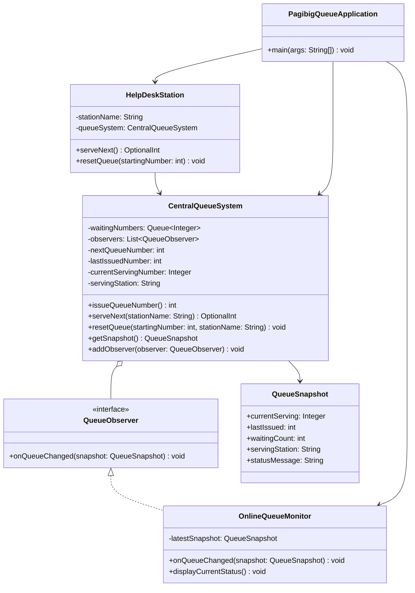

# Centralized Queuing System for Pag-ibig Office

## Problem Statement

The Pag-ibig office implements a centralized queuing system for three help desk stations. Individuals visiting the office obtain a queue number from this centralized system. Additionally, there's an online monitoring system that displays the current queued number in real-time for individuals monitoring the queue remotely.

Each help desk station has an option to reset the queuing number based on an inputted number, allowing flexibility in managing the queue during specific situations, such as reorganization or technical issues. This queuing system ensures a single centralized queue number for all help desk stations, while the reset option offers control and adjustment in exceptional circumstances.

This approach aims to maintain an organized queuing process for individuals visiting the office and provides the flexibility to handle queue adjustments as needed.

## UML Class Diagram



## Design Summary

- All three help desks share one `CentralQueueSystem`, so queue numbers are issued from one centralized sequence.
- Waiting numbers are stored in first-in, first-out order.
- Any help desk can call the next waiting number.
- Any help desk can reset the sequence to an entered starting number. A reset clears the old waiting list to prevent duplicate or stale numbers.
- `OnlineQueueMonitor` observes queue changes and immediately displays the latest number, station, and number of people waiting.
- Queue operations are protected by a lock so multiple stations can safely use the same queue.

## Project Structure

```text
src/main/java/ph/gov/pagibig/queue/
  CentralQueueSystem.java
  HelpDeskStation.java
  OnlineQueueMonitor.java
  PagibigQueueApplication.java
  QueueObserver.java
  QueueSnapshot.java
```

## Compile and Run

From the project root:

```bash
javac -d out src/main/java/ph/gov/pagibig/queue/*.java
java -cp out ph.gov.pagibig.queue.PagibigQueueApplication
```

The application opens a console menu for issuing numbers, serving the next person at any of the three desks, resetting the queue, and viewing the online monitor.

